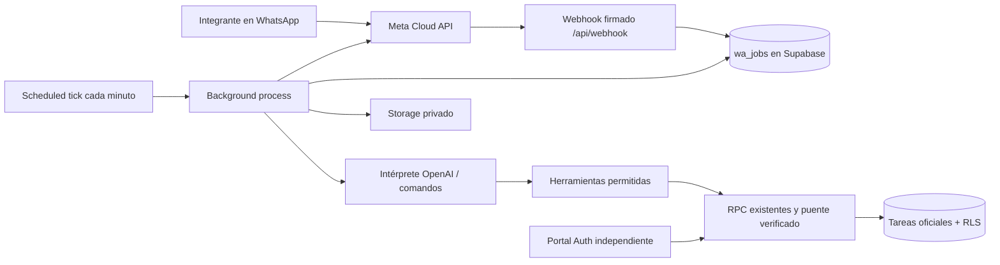

> Actualización de despliegue: usar [la guía de Vercel](04_CONFIGURACION_VERCEL.md). Las referencias a Netlify de este documento corresponden al adaptador anterior. En Vercel se añade `CRON_SECRET`, no se necesita `URL` y el cron por minuto requiere Pro.

# 01 · Arquitectura implementada y auditoría

## Sistema encontrado

La raíz contiene una app Expo/React Native, y `web/` su versión React orientada a escritorio. No existen carpetas `frontend/` y `backend/`, ni configuración Netlify previa. El backend real son RPC PostgreSQL, RLS y las Edge Functions `administracion` y `enviar-push` de Supabase. El repositorio se identifica como Team's Ohana; este módulo usa la marca Alba Flow solicitada sin renombrar el aplicativo.

Las tablas oficiales son `usuarios`, `usuarios_empresas`, `empresas`, `areas`, `equipos`, `miembros_equipo`, `tableros`, `participantes_tablero`, `tareas`, `subtareas`, `evidencias`, `transiciones_tarea`, `comentarios_tarea`, `eventos_tarea` y `preferencias_usuario`. No hay entidad independiente "proyectos". El bot informa del tablero/equipo disponible, sin inventar relaciones.

Los estados reales son `por_hacer`, `en_curso`, `en_revision`, `finalizado`. Los roles de empresa son `administrador`, `lider`, `miembro`; el liderazgo se asigna por equipo. Las funciones `privado.ve_tarea`, `privado.gestiona_tarea`, `privado.trabaja_tarea` y las RPC de transición siguen siendo la autoridad. El número nunca otorga un rol.

## Componentes

`src/api` maneja sesiones y administración; `webhooks` valida firma HMAC sobre bytes originales; `database` usa HTTPS REST/RPC sin un SDK acoplado; `ai` selecciona herramientas estrictas; `tasks` dirige operaciones; `evidence` limita y valida imágenes; `automations` procesa la cola. Los módulos no requieren dependencias de producción. PGlite es exclusivamente de pruebas.

## Identidad y permisos

El usuario inicia sesión en el portal con su cuenta Supabase. Su JWT queda solo en memoria de la pestaña. La empresa se selecciona entre membresías activas, y las operaciones administrativas vuelven a comprobar el rol en SQL. Para vincular, se genera un código aleatorio de 192 bits, se guarda únicamente SHA-256 y se exige enviarlo desde el número solicitado al número corporativo. Caduca en 10 minutos y se consume una vez.

Las herramientas del trabajador solo pueden llamar `wa_actor_action` con un vínculo verificado. Ese puente, exclusivo de `service_role`, establece la identidad dentro de la transacción y reutiliza los permisos originales; comprueba la empresa antes de leer cualquier tarea. No acepta SQL, nombres arbitrarios de función ni identidades elegidas por la IA. Si hay varias empresas vinculadas al mismo número, el usuario elige con `EMPRESA <id>`.

## Fotografías

Meta entrega un identificador, nunca una URL elegida por el usuario. Se recupera el descriptor desde Graph, se permite únicamente HTTPS en los hosts multimedia previstos, se rechazan redirecciones y se limita la descarga mientras llega. Se contrastan MIME, firma del archivo y SHA-256 cuando Meta lo proporciona. Se guarda en `evidencias-tareas`, privado.

Para una transición se reutilizan `preparar_transicion` y `guardar_transicion`, con versión y UUID estable. El estado, evidencia y comentario se confirman juntos. Un trigger diferido exige fotografía de la misma transición/version al finalizar y verifica su objeto en Storage. Adjuntos antiguos no cumplen esa comprobación. Los avances sin cambio de estado añaden evidencia/comentario/evento a las tablas existentes mediante operaciones idempotentes.

La inspección de firma/MIME no sustituye un antivirus ni un análisis forense de contenido. La app conserva sus propias transformaciones de imágenes. No se han introducido rutas públicas a buckets.

## Entrega, orden y privacidad

`wa_jobs` tiene claves únicas, leases, token de propietario y reintentos. Los mensajes de una conversación se procesan en orden. Los errores de conexión de un envío pueden tener resultado incierto: no se reenvían automáticamente. Los webhooks de entrega usan el identificador del trabajo y no retroceden de leído/entregado a enviado.

Fuera de 24 horas se permite solo la plantilla utilitaria configurada, sin variables. Las imágenes esperan una nueva ventana. Hay una reserva de plantilla por vínculo y 24 horas para consolidar avisos. El historial de tareas continúa en el sistema oficial; el bot añade auditoría de sus acciones. No se registran contraseñas, tokens ni cuerpos de mensajes en los logs de Functions.

## Fuentes consultadas

- [Supabase: funciones de base de datos](https://supabase.com/docs/guides/database/functions).
- [OpenAI: herramientas con function calling](https://developers.openai.com/api/docs/guides/function-calling).
- [Netlify: funciones en segundo plano](https://docs.netlify.com/build/functions/background-functions/).
